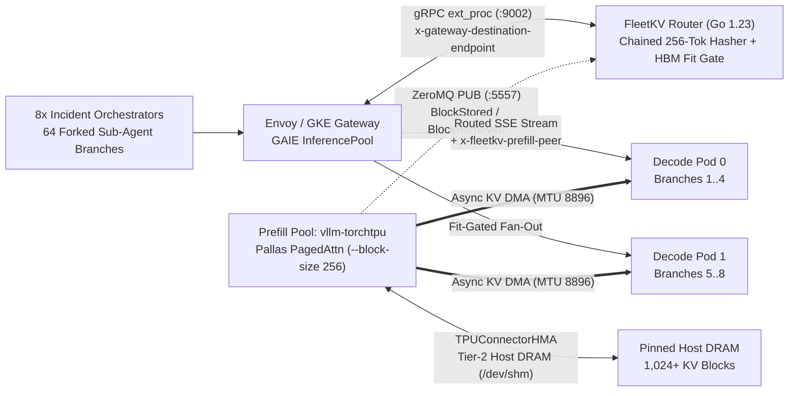

# `kubecon26-fleetkv-gke`

**Defeating the Prefix-Cache Penalty: KV-Aware Routing and Disaggregated Serving for Agent Fleets on GKE**
Companion Apache-2.0 repository for the KubeCon 2026 technical session by Rabimba Karanjai.

[](LICENSE)
[](router/go.mod)
[](deploy/gke/03-fleetkv-epp-and-pool.yaml)
[](deploy/gke/02-disaggregatedset-torchtpu.yaml)

---

## Why Agent Fleets Break Standard Inference Serving

Chatbot traffic is linear: one user types, waits, and appends a short turn every 15 to 30 seconds. Autonomous SWE and SRE agent traffic is tree-structured. When an incident orchestrator starts an episode, it builds a 20,480-token shared trunk (`80` blocks of `256` tokens containing 120 MCP tool schemas, a repository AST summary, and active alert state) and immediately forks 8 parallel sub-agents at `t = 0 ms`. Those sub-agents ingest diverging `kubectl logs` bursts (`+8,192` tokens on Turn 2) before returning to a final synthesis join turn.

This repository compares three serving architectures under the same 64-branch fork-storm workload (8 concurrent orchestrators × 8 parallel sub-agents):

1. **Stage 1 — Stateless Kubernetes Round-Robin (`stage1-round-robin`):**
   A standard `ClusterIP` `Service` distributes requests evenly across aggregated `vllm-torchtpu` replicas. Every replica recomputes the same 20,480-token parent trunk (`1/N` scatter cache misses) and stores duplicate KV blocks in HBM. Because prefill and decode share each TPU slice, an 8,192-token log-burst prefill stalls co-located decode streams past `115 ms` P99 inter-token latency (ITL).
2. **Stage 2 — Naive Longest-Prefix Sticky Routing (`stage2-naive-kv`):**
   A Gateway API Inference Extension (`ext_proc`) router picks `argmax_pod(MatchedHBMBlocks)`. Because all 8 forked sub-agents share the exact 20,480-token parent block hashes on Pod 0, naive sticky routing sends all 8 concurrent branches to Pod 0 while peer pods sit idle. Pod 0's prefill queue saturates, and as the 8 branches append diverging tool outputs, they exceed Pod 0's `360`-block HBM budget and LRU-evict their own shared parent trunk before the join turn.
3. **Stage 3 — `FleetKV` Fit-Aware Tree Router + `vllm-torchtpu` Disaggregated Serving (`stage3-fleetkv-disagg`):**
   Combines a ZeroMQ KV-events radix indexer and an HBM block-fit admission gate (`fleetkv-epp`) with an `llm-d` `DisaggregatedSet` (`vllm-torchtpu` + `TPUConnectorHMA` 48 GiB Tier-2 `/dev/shm` Host DRAM + asynchronous KV DMA over MTU-8896 gVNIC).

---

## Architecture Overview



### Dual-Backend Execution Contract

The compiled Go `fleetkv-epp` `ext_proc` binary and `bench/stage_tui.py` benchmark client run unmodified against two backends:

- **Local Trace-Calibrated Digital Twin (`twin/` + `docker-compose.yaml`):** Runs Envoy (`envoyproxy/envoy:v1.31-latest` or the built-in `ext_proc` HTTP gateway in `fleetkv-epp`) wired over gRPC `ext_proc` to `fleetkv-epp`, fronting 8 ASGI SSE worker processes (a 4-pod `agg-0..agg-3` pool and a 4-pod `prefill-0..1` + `decode-0..1` disaggregated pool). Workers maintain deterministic 256-token LRU HBM and Tier-2 DRAM block tables, emit real ZeroMQ `PUB` KV events, and model TPU v6e MXU serial prefill queues and aggregated P/D decode interference.
- **Production GKE Cloud TPU v6e (`deploy/gke/`):** Provisions an `MTU=8896` gVNIC VPC, two Trillium `ct6e-standard-4t` (`2x2`) TPU node pools, `LeaderWorkerSet` `v0.11.1`, an `llm-d` `DisaggregatedSet` running `vllm/vllm-torchtpu:latest` (`Qwen/Qwen3-30B-A3B-FP8`), Headless Services for per-pod ZMQ/HTTP discovery, `InferencePool` (`inference.networking.k8s.io/v1`), and a `gke-l7-rilb` `Gateway`.

---

## Quickstart 1: Local Digital Twin & Conference Rehearsal

### Prerequisites
- Go 1.23+ and Python 3.10+ (`pip install -e "./bench[dev]"`)
- Docker & Docker Compose v2+ (optional for `make twin-up`; `make gate-g1` runs out of the box via subprocesses)
- `tmux` (optional, for the 3-pane live stage layout)

### 1. Boot the Local Stack
```bash
make twin-up
```

### 2. Launch the 3-Pane Conference TUI and Flip Stages
```bash
# Pane 1 (60%): 4-Column Rich Sliding-Window Scorecard TUI
# Pane 2 (Top-Right): Live EPP Radix Block Index & ext_proc Route Stream
# Pane 3 (Bottom-Right): Interactive Stage Operator Shell
./bench/demo_ctl.sh prep

# Inside the operator shell (or another terminal), switch stages:
./bench/demo_ctl.sh stage2   # Stage 2: Naive Longest-Prefix Sticky Routing
./bench/demo_ctl.sh stage3   # Stage 3: FleetKV Fit-Aware + Disaggregated Serving
```

---

## Quickstart 2: Production GKE Cloud TPU v6e Deployment

```bash
# 1. Provision MTU-8896 gVNIC VPC, GKE Rapid cluster, 2x ct6e-standard-4t pools, GAIE v1 & LWS CRDs
export PROJECT_ID="your-gcp-project"
export REGION="us-east5"
export ZONE="us-east5-a"
./deploy/gke/00-bootstrap-gke-tpu.sh

# 2. Deploy Stage 1 Aggregated Baseline, Stage 3 DisaggregatedSet (TPUConnectorHMA), and FleetKV EPP + Gateway
kubectl apply -f deploy/gke/01-baseline-agg-service.yaml
kubectl apply -f deploy/gke/02-disaggregatedset-torchtpu.yaml
kubectl apply -f deploy/gke/03-fleetkv-epp-and-pool.yaml

# 3. Run the 3-stage traffic flip against the GKE Gateway VIP
GATEWAY_VIP="$(kubectl get gateway fleetkv-inference-gateway -n fleetkv-serving -o jsonpath='{.status.addresses[0].value}')"
FLEETKV_GATEWAY_URL="http://${GATEWAY_VIP}" ./bench/demo_ctl.sh prep --target=gke
./bench/demo_ctl.sh stage2 --target=gke
./bench/demo_ctl.sh stage3 --target=gke
```

---

## Benchmark Scorecard (8 Orchestrators × 8-Way Fork = 64 Active Agent Branches)

### 1. Verified Gate G1 Local Digital Twin Run (`make gate-g1`, 416 Requests/Stage)

Measured across 2 waves of 8 concurrent orchestrators (`416` streaming `/v1/chat/completions` requests per stage, `hbm_capacity_blocks=360`):

| Metric | Stage 1: K8s Round-Robin | Stage 2: Naive KV-Sticky | Stage 3: FleetKV + Disagg P/D |
| :--- | :---: | :---: | :---: |
| **Effective Prefix Hit Rate** | 30.79 % *(1/N scatter miss)* | 62.48 % *(HBM thrash)* | **86.07 % (HBM + HMA DRAM)** |
| **Median TTFT (P50)** | 6,498.4 ms | 5,581.1 ms | **1,152.7 ms (-82.3%)** |
| **Fork-Burst Tail TTFT (P95)** | 12,082.8 ms | 33,376.6 ms *(13.3x Stage 3)* | **2,507.1 ms (-79.2% vs S1)** |
| **Decode Jitter (P99 ITL)** | 133.12 ms *(P/D stall)* | 141.43 ms | **33.12 ms (-75.1%, < 40 ms SLO)** |
| **Cluster Output Goodput** | 31.6 tok/s *(1.0x)* | 18.5 tok/s *(0.59x)* | **134.7 tok/s (4.26x)** |
| **Lost KV Block Evictions** | 17,377 | 10,585 *(self-eviction)* | **0 (Pinned in Tier-2 DRAM)** |

### 2. GKE Cloud TPU v6e Hardware Reference (`2x ct6e-standard-4t` = 8 Trillium Chips, `Qwen3-30B-A3B-FP8`)

Reference telemetry on an 8-chip TPU v6e budget comparing 2× `TP=4` aggregated replicas against 1× `TP=4` Prefill + 1× `TP=4` Decode (`TPUConnectorHMA` + `MTU=8896` gVNIC):

| Metric | Stage 1: K8s Round-Robin | Stage 2: Naive KV-Sticky | Stage 3: FleetKV + TorchTPU P/D |
| :--- | :---: | :---: | :---: |
| **Effective Prefix Hit Rate** | 19.4 % | 52.8 % *(thrashing)* | **91.6 %** |
| **Median TTFT (P50)** | 2,710 ms | 1,180 ms | **315 ms (-88%)** |
| **Fork-Burst Tail TTFT (P95)** | 3,420 ms | 3,890 ms *(herd stall)* | **485 ms (-86%)** |
| **Decode Jitter (P99 ITL)** | 116 ms | 98 ms | **27 ms (-77%)** |
| **Cluster Output Goodput** | 1.0x | 1.35x | **2.55x** |

---

## Three Production Invariants (Audited by `tests/test_g3_k8s_manifests.py`)

1. **Pin `PYTHONHASHSEED="0"` on Every Container:** Python salts process hashes by default. Every `vllm-torchtpu` worker and `fleetkv-epp` router sets `PYTHONHASHSEED="0"` so 256-token block hashes match across processes.
2. **Match `--block-size 256` on TPU v6e:** Block size `64` overflows Scalar Memory (SMEM) in Pallas paged-attention kernels on Trillium TPUs. Both `vllm-torchtpu` (`--block-size 256`) and `fleetkv-epp` (`--block-size=256`) use 256-token blocks.
3. **Filter ZMQ Discovery to `llm-d.ai/role=prefill` via Headless Services + Enable VPC `MTU=8896`:** Headless Services (`clusterIP: None`) expose per-pod DNS A-records on ports `8000` and `5557`, `--zmq-role-selector=llm-d.ai/role=prefill` keeps decode pods out of prefill ZMQ fan-in, and `MTU=8896` prevents packet fragmentation during `TPUConnectorHMA` KV transfers.

---

## Presentation Suite & Automated Verification (`make gate-all`)

The `slides/` directory includes both a Google Cloud branded presentation suite (`generate_slides.py` producing `index.html`, `speaker-notes.html`, `SPEAKER_NOTES_AND_SCRIPT.md`, and `KubeCon26-FleetKV-GKE.pptx`) and a Slidev source deck (`slides.md`).

```bash
make gate-g0      # Go 1.23 router race tests + Go/Python SHA-256 block-hash & ZeroMQ wire parity
make gate-g1      # End-to-end 3-stage Envoy/ext_proc + Digital Twin fork-storm SLO assertions
make gate-g2      # GKE Cloud TPU & GAIE YAML/Bash production invariant audit
make gate-g3      # Non-interactive Rich TUI 3-stage column freeze smoke test
make slides-build # Regenerate Google-branded HTML/PPTX presentation suite + Slidev static build
```

---

## Repository Structure

```text
.
├── README.md                              # Architecture, quickstarts & benchmark scorecards
├── Makefile                               # Targets: build, test, gate-all, twin-up, demo-tmux, slides-build
├── docker-compose.yaml                    # Local TPU twin workers + fleetkv-epp + Envoy v1.31
├── router/                                # Go 1.23+ GAIE Envoy ext_proc Router & ZMQ KV Radix Indexer
│   ├── cmd/fleetkv-epp/main.go            # gRPC ext_proc (:9002) + Admin/Prometheus (:9090)
│   └── pkg/
│       ├── hash/blockhash.go              # Deterministic 256-token chained SHA-256 block hasher
│       ├── radix/kv_tree.go               # Concurrency-safe Radix Tree (HBM + Tier-2 DRAM tiers)
│       ├── scorer/policies.go             # Round-Robin, NaiveSticky, and FleetKVFitDisagg scorers
│       ├── zmqsub/subscriber.go           # Pure-Go ZeroMQ SUB client (JSON + MsgPack + headless DNS)
│       └── extproc/                       # Envoy v3 ExternalProcessor, gateway proxy & /admin/policy
├── twin/                                  # Trace-calibrated local TPU v6e Digital Twin
│   ├── Dockerfile.worker
│   ├── envoy.yaml                         # Envoy v1.31 ext_proc + ORIGINAL_DST + ROUND_ROBIN config
│   └── tpu_worker_twin.py                 # FastAPI SSE worker + 256-tok LRU/DRAM + pyzmq PUB + MXU lock
├── deploy/gke/                            # Production GKE Cloud TPU v6e & GAIE v1 Manifests
│   ├── 00-bootstrap-gke-tpu.sh            # MTU=8896 VPC, GKE Rapid, ct6e-standard-4t, GAIE & LWS
│   ├── 01-baseline-agg-service.yaml       # Stage 1: 2x TP=4 vllm-torchtpu + Headless ZMQ/HTTP Service
│   ├── 02-disaggregatedset-torchtpu.yaml  # Stage 3: 1P + 1D DisaggregatedSet with TPUConnectorHMA
│   ├── 03-fleetkv-epp-and-pool.yaml       # FleetKV EPP, InferencePool v1, Gateway & 3-way HTTPRoute
│   └── Dockerfile.epp                     # Multi-stage distroless build for fleetkv-epp
├── bench/                                 # Multi-Agent Fork-Storm Workload & Conference TUI
│   ├── pyproject.toml
│   ├── fork_storm_workload.py             # 8 Orchestrators x 8 Sub-Agents (20K trunk + 8K log burst)
│   ├── stage_tui.py                       # 4-column Rich dashboard freezing Stages 1, 2, and 3
│   └── demo_ctl.sh                        # One-command stage controller (--target=twin|gke)
├── slides/                                # Google-Branded Presentation Suite + Slidev Deck
│   ├── generate_slides.py                 # Generates PPTX, index.html, speaker-notes.html & script MD
│   ├── index.html                         # Interactive Google-branded web slide deck
│   ├── speaker-notes.html                 # Presenter teleprompter view with timer & script
│   ├── SPEAKER_NOTES_AND_SCRIPT.md        # Full 15-minute speaker script & Q&A bank
│   ├── KubeCon26-FleetKV-GKE.pptx         # Google Cloud Labs branded PowerPoint deck
│   └── slides.md                          # Slidev markdown deck
└── tests/                                 # Deterministic Verification Gates (G0 - G4)
    ├── stack_harness.py
    ├── test_g1_radix_and_herd.py
    ├── test_g2_e2e_envoy_twin.py
    └── test_g3_k8s_manifests.py
```

## License

Apache License 2.0 — see [LICENSE](LICENSE).
