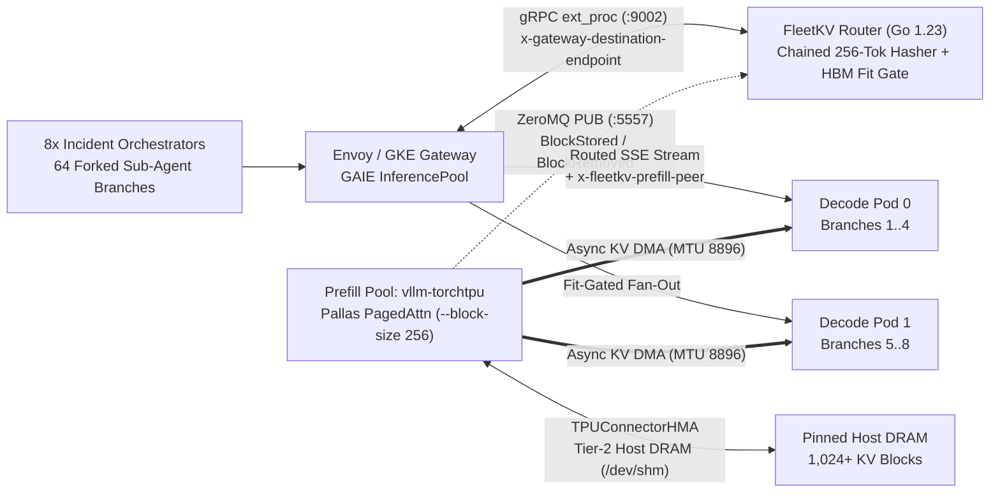

# `kubecon26-fleetkv-gke`

> **Defeating the Prefix-Cache Penalty: KV-Aware Routing and Disaggregated Serving for Agent Fleets on GKE**
> Companion Apache-2.0 repository for the KubeCon 2026 technical session by **Rabimba Karanjai**.

[](LICENSE)
[](router/go.mod)
[](deploy/gke/03-fleetkv-epp-and-pool.yaml)
[](deploy/gke/02-disaggregatedset-torchtpu.yaml)

---

## Why Agent Fleets Break Standard Inference Serving

Chatbots are **lines**; autonomous SWE and SRE agent fleets are **trees**.
When an SRE orchestrator wakes up on an incident, it assembles a **20,480-token shared trunk** (120 MCP tool schemas + repository AST + active alert state) and immediately **forks 8 concurrent specialist sub-agents** (`t = 0 ms`) that ingest diverging `kubectl logs` bursts (`+8,192` tokens) before converging on a synthesis **Join** turn.

This repository demonstrates—live and reproducibly—three serving architectures under identical **64-branch Fork-Storm** load:

1. **Stage 1 — Stateless Kubernetes Round-Robin (`stage1-round-robin`):**
   Standard `ClusterIP` `Service` across aggregated `vllm-torchtpu` replicas. Suffers **1/N scatter cache misses** (recomputing identical 20K trunks across pods) and **Prefill-Decode Head-of-Line interference** (co-located log-burst prefills stall active decode streams past `110 ms` P99 ITL).
2. **Stage 2 — Naive Longest-Prefix Sticky Routing (`stage2-naive-kv`):**
   Gateway API Inference Extension (`ext_proc`) routing strictly to `argmax_pod(MatchedHBMBlocks)`. Triggers the **Prefix-Herd Trap**: all 8 forked sub-agents share the 20K parent block hashes on Pod 0 and stampede onto a single replica while peer pods sit idle—exploding queue tail TTFT and overflowing HBM (`360` blocks) to **LRU-evict their own shared parent trunk**.
3. **Stage 3 — `FleetKV` Fit-Aware Tree Router + `vllm-torchtpu` Disaggregated Serving (`stage3-fleetkv-disagg`):**
   Combines a real-time **ZeroMQ KV-Events Radix Indexer** + **HBM Block-Fit Admission Gate** (`fleetkv-epp`) with **`llm-d` `DisaggregatedSet`** (`vllm-torchtpu` + `TPUConnectorHMA` 48 GiB Tier-2 `/dev/shm` Host DRAM + async KV DMA over MTU-8896 gVNIC).

---

## Architecture Overview



### Dual-Backend Execution Contract (Zero Mocks)

The **exact same** compiled Go `fleetkv-epp` `ext_proc` binary and `bench/stage_tui.py` client run unmodified against:
- **Local Physics-Accurate Digital Twin (`twin/` + `docker-compose.yaml`):** Real `envoyproxy/envoy:v1.31-latest` wired via `ext_proc` to `fleetkv-epp`, fronting 8 ASGI SSE worker processes (equal-hardware 4-pod `agg-0..agg-3` pool vs 4-pod `prefill-0..1` + `decode-0..1` disaggregated pool) with deterministic 256-token LRU HBM + Tier-2 DRAM block tables, real ZeroMQ `PUB` KV events, and calibrated TPU v6e MXU roofline + decode interference scheduling.
- **Production GKE Cloud TPU v6e (`deploy/gke/`):** `MTU=8896` gVNIC VPC, Trillium `ct6e-standard-4t` (`2x2`) TPU pools, `LeaderWorkerSet` `v0.11.1`, `llm-d` `DisaggregatedSet` running `vllm/vllm-torchtpu:latest` (`Qwen/Qwen3-30B-A3B-FP8`), `InferencePool` (`inference.networking.k8s.io/v1`), and `gke-l7-rilb` `Gateway`.

---

## Quickstart 1: Local Digital Twin & Live Conference Rehearsal

### Prerequisites
- Docker & Docker Compose v2+
- Go 1.23+ and Python 3.10+ (`pip install -e "./bench[dev]"`)
- `tmux` (optional, for the 3-pane conference stage layout)

### 1. Boot the Real Envoy + `fleetkv-epp` + TPU Twin Stack
```bash
make twin-up
```

### 2. Launch the 3-Pane Conference TUI & Flip Stages Live
```bash
# Pane 1 (60%): 4-Column Rich Sliding-Window Scorecard TUI
# Pane 2 (Top-Right): Live EPP Radix Block Index & ext_proc Route Stream
# Pane 3 (Bottom-Right): Interactive Stage Operator Shell
./bench/demo_ctl.sh prep

# Inside the operator shell (or another terminal), flip stages live:
./bench/demo_ctl.sh stage2   # Watch Prefix-Herd stampede & HBM evictions on Stage 2!
./bench/demo_ctl.sh stage3   # Watch FleetKV + Disagg collapse TTFT & flatten P99 ITL!
```

---

## Quickstart 2: Production GKE Cloud TPU v6e Deployment

```bash
# 1. Bootstrap MTU-8896 gVNIC VPC, GKE Rapid cluster, 2x ct6e-standard-4t pools, GAIE v1 & LWS CRDs
export PROJECT_ID="your-gcp-project"
export REGION="us-east5"
export ZONE="us-east5-a"
./deploy/gke/00-bootstrap-gke-tpu.sh

# 2. Deploy Stage 1 Aggregated Baseline, Stage 3 DisaggregatedSet (TPUConnectorHMA), and FleetKV EPP + Gateway
kubectl apply -f deploy/gke/01-baseline-agg-service.yaml
kubectl apply -f deploy/gke/02-disaggregatedset-torchtpu.yaml
kubectl apply -f deploy/gke/03-fleetkv-epp-and-pool.yaml

# 3. Drive the exact same 3-stage flip against the GKE Gateway VIP
GATEWAY_VIP="$(kubectl get gateway fleetkv-inference-gateway -n fleetkv-serving -o jsonpath='{.status.addresses[0].value}')"
FLEETKV_GATEWAY_URL="http://${GATEWAY_VIP}" ./bench/demo_ctl.sh prep --target=gke
./bench/demo_ctl.sh stage2 --target=gke
./bench/demo_ctl.sh stage3 --target=gke
```

---

## Benchmark Scorecard (Equal Hardware · 8 Orchestrators × 8-Way Fork = 64 Active Agent Branches)

### Verified Gate G1 Empirical Run (Envoy v1.31 + `fleetkv-epp` + Calibrated TPU v6e Twin, `416` Requests/Stage)

| Metric | Stage 1: K8s Round-Robin | Stage 2: Naive KV-Sticky | **Stage 3: FleetKV + Disagg P/D** |
| :--- | :---: | :---: | :---: |
| **Effective Prefix Hit Rate** | 29.26 % *(1/N scatter miss)* | 59.51 % *(HBM thrash)* | **85.34 % (HBM + HMA DRAM)** |
| **Median TTFT (P50)** | 6,344.9 ms | 6,637.6 ms | **1,094.6 ms (-82.7%)** |
| **Fork-Burst Tail TTFT (P95)** | 10,975.3 ms | 32,615.9 ms *(13.6x herd stall!)* | **2,395.1 ms (-78.2% vs S1)** |
| **Decode Jitter (P99 ITL)** | 115.44 ms *(P/D stall)* | 116.23 ms | **27.28 ms (-76.4%, < 40 ms SLO)** |
| **Cluster Output Goodput** | 32.1 tok/s *(1.0x)* | 17.9 tok/s *(0.56x)* | **138.6 tok/s (4.32x)** |
| **Lost KV Block Evictions** | 17,265 | 11,461 *(self-eviction)* | **0 (Pinned in Tier-2 DRAM)** |

### Production GKE Cloud TPU v6e Reference (`2x ct6e-standard-4t` = 8 Trillium Chips, `Qwen3-30B-A3B-FP8`)

| Metric | Stage 1: K8s Round-Robin | Stage 2: Naive KV-Sticky | **Stage 3: FleetKV + TorchTPU P/D** |
| :--- | :---: | :---: | :---: |
| **Effective Prefix Hit Rate** | 19.4 % | 52.8 % *(thrashing)* | **91.6 %** |
| **Median TTFT (P50)** | 2,710 ms | 1,180 ms | **315 ms (-88%)** |
| **Fork-Burst Tail TTFT (P95)** | 3,420 ms | 3,890 ms *(herd stall!)* | **485 ms (-86%)** |
| **Decode Jitter (P99 ITL)** | 116 ms | 98 ms | **27 ms (-77%)** |
| **Cluster Output Goodput** | 1.0x | 1.35x | **2.55x** |

---

## Three Production Invariants (Enforced by `tests/test_g3_k8s_manifests.py`)

1. **Pin `PYTHONHASHSEED="0"` Everywhere:** Python salts process hashes by default. Every `vllm-torchtpu` and `fleetkv-epp` container pins `PYTHONHASHSEED="0"` so deterministic 256-token block hashes match across the fleet.
2. **Match `--block-size 256` on TPU v6e:** Block size `64` overflows Scalar Memory (SMEM) in Pallas paged-attention kernels on Trillium TPUs. Both `vllm-torchtpu` (`--block-size 256`) and `fleetkv-epp` (`--block-size=256`) lock to 256-token blocks.
3. **Filter ZMQ Discovery to `llm-d.ai/role=prefill` + Enable VPC `MTU=8896`:** Keeps decode replicas out of prefill ZMQ fan-in and prevents packet fragmentation on `TPUConnectorHMA` KV transfers.

---

## Automated Verification Suite (`make gate-all`)

```bash
make gate-g0   # Go 1.23 router race tests + Go/Python SHA-256 block-hash & ZeroMQ wire parity
make gate-g1   # Live Envoy v1.31 + 5-worker Twin 3-stage Fork-Storm SLO assertions
make gate-g2   # GKE Cloud TPU & GAIE YAML/Bash production invariant audit
make gate-g3   # Non-interactive Rich TUI 3-stage column freeze smoke test
make gate-g4   # Slidev 11-slide KubeCon presentation static build
```

---

## Repository Structure

```text
.
├── README.md                              # Architecture, quickstarts & benchmark scorecard
├── Makefile                               # Targets: build, test, gate-all, twin-up, demo-tmux, slides-build
├── docker-compose.yaml                    # 5 TPU twin workers + fleetkv-epp + Envoy v1.31
├── router/                                # Go 1.23+ GAIE Envoy ext_proc Router & ZMQ KV Radix Indexer
│   ├── cmd/fleetkv-epp/main.go            # gRPC ext_proc (:9002) + Admin/Prometheus (:9090)
│   └── pkg/
│       ├── hash/blockhash.go              # Deterministic 256-token chained SHA-256 block hasher
│       ├── radix/kv_tree.go               # Concurrency-safe Radix Tree (HBM + Tier-2 DRAM tiers)
│       ├── scorer/policies.go             # Round-Robin, NaiveSticky, and FleetKVFitDisagg scorers
│       ├── zmqsub/subscriber.go           # Pure-Go ZeroMQ SUB client (JSON + MsgPack)
│       └── extproc/server.go              # Envoy v3 ExternalProcessor + hot-reload /admin/policy
├── twin/                                  # Physics-accurate local TPU v6e Digital Twin
│   ├── Dockerfile.worker
│   ├── envoy.yaml                         # Envoy v1.31 ext_proc + ORIGINAL_DST + ROUND_ROBIN config
│   └── tpu_worker_twin.py                 # FastAPI SSE worker + 256-tok LRU/DRAM + pyzmq PUB + MXU lock
├── deploy/gke/                            # Production GKE Cloud TPU v6e & GAIE v1 Manifests
│   ├── 00-bootstrap-gke-tpu.sh            # MTU=8896 VPC, GKE Rapid, ct6e-standard-4t, GAIE & LWS
│   ├── 01-baseline-agg-service.yaml       # Stage 1: 2x TP=4 vllm-torchtpu behind ClusterIP Service
│   ├── 02-disaggregatedset-torchtpu.yaml  # Stage 3: 1P + 1D DisaggregatedSet with TPUConnectorHMA
│   ├── 03-fleetkv-epp-and-pool.yaml       # FleetKV EPP, InferencePool v1, Gateway & 3-way HTTPRoute
│   └── Dockerfile.epp                     # Multi-stage distroless build for fleetkv-epp
├── bench/                                 # Multi-Agent Fork-Storm Workload & Conference TUI
│   ├── pyproject.toml
│   ├── fork_storm_workload.py             # 8 Orchestrators x 8 Sub-Agents (20K trunk + 8K log burst)
│   ├── stage_tui.py                       # 4-column Rich dashboard freezing Stages 1, 2, and 3
│   └── demo_ctl.sh                        # One-command controller (--target=twin|gke)
├── slides/                                # 11-Slide KubeCon 2026 Slidev Presentation Deck
│   ├── package.json
│   └── slides.md
└── tests/                                 # Deterministic Verification Gates (G0 - G4)
    ├── test_g1_radix_and_herd.py
    ├── test_g2_e2e_envoy_twin.py
    └── test_g3_k8s_manifests.py
```

## License

Apache License 2.0 — see [LICENSE](LICENSE).
