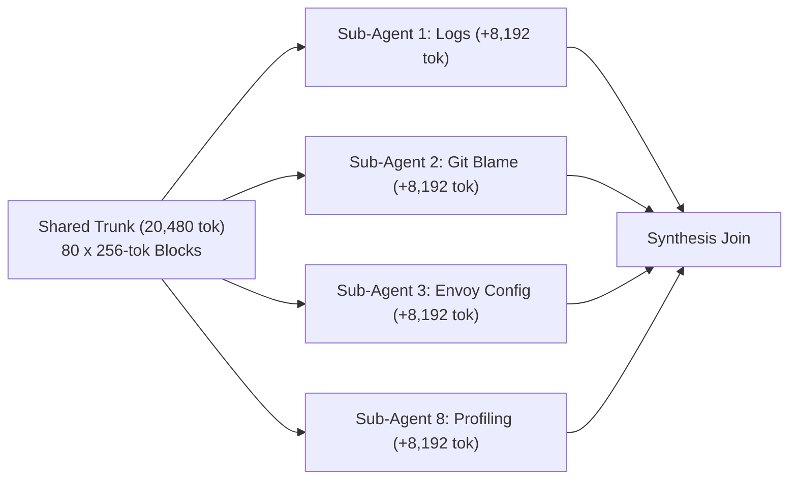
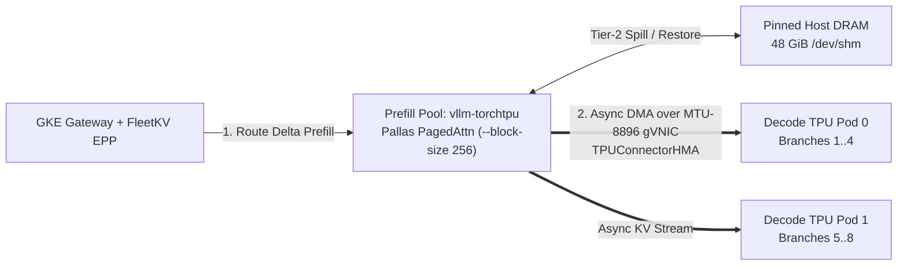

# Defeating the Prefix-Cache Penalty
### KV-Aware Routing & Disaggregated Serving for Agent Fleets on GKE

<div class="pt-6 text-lg opacity-90">
  <strong>Rabimba Karanjai</strong> · KubeCon 2026
</div>

<div class="pt-4 text-sm opacity-90">
  Gateway API Inference Extension · <span class="font-mono px-1.5 py-0.5 rounded bg-black/35">llm-d</span> · <span class="font-mono px-1.5 py-0.5 rounded bg-black/35">vllm-torchtpu</span> · GKE Cloud TPU
</div>

<!--
[00:00 - 00:35]
Kubernetes services were built around a simple assumption: HTTP requests are independent, pods are interchangeable, and round-robin spreads load evenly. When you run an autonomous SWE or SRE agent fleet behind a stateless Service, you spend most of your accelerator cycles recomputing identical prompt prefixes across replicas. And if you switch to naive longest-prefix sticky routing, parallel agent fan-out herds onto a single pod and makes P95 tail latency worse than round-robin. In this session, we will walk through why both failures happen and how we fix them using Gateway API Inference Extension and disaggregated TorchTPU serving on GKE.
-->

---

# Chatbots Are Lines. Agent Fleets Are Trees.

<div class="grid grid-cols-2 gap-4 pt-1 text-xs">
<div>

### Chatbot Traffic
- Single linear user session
- Human typing pace (15–30s between turns)
- Small system prompt (~1K tokens)
- Predictable HBM growth per request

</div>

<div>

### SWE / SRE Agent Fleet
- **20,480-Token Shared Trunk:** 120 MCP tool schemas + repo AST + alert context (`80` blocks of `256` tokens)
- **8-Way Fork (`t = 0 ms`):** Orchestrator spawns 8 parallel specialist sub-agents simultaneously
- **Tool Log Bursts:** Each sub-agent appends `+8,192` tokens of `kubectl logs` and `git diff` output on Turn 2
- **Synthesis Join:** Orchestrator merges all 8 branch findings

</div>

</div>



<!--
[00:35 - 01:45]
Why do agent fleets break standard serving pools? Because a chatbot is a line, whereas an agent workflow is a tree. When an incident orchestrator triggers on an alert, it assembles a 20,480-token shared trunk—80 blocks of 256 tokens holding MCP tool schemas, repository structure, and alert state—and at millisecond zero spawns 8 parallel sub-agents. Each sub-agent pulls 8,192 tokens of pod logs and diffs before converging on a synthesis turn. Over the episode, more than 85% of tokens across those branches are shared prefix blocks.
-->

---

# Failure Mode 1: Stateless K8s & The Scatter Penalty

A standard `ClusterIP` `Service` distributes forked sub-agents across $N$ replicas without prefix state:

- **1/N Cache Scatter:** Pods 0 through 3 each recompute the same 20,480-token parent trunk on their Matrix Multiply Units (MXUs).
- **Duplicate HBM Residency:** Identical 20,480-token FP8 KV blocks occupy $N \times$ High-Bandwidth Memory across the pool.
- **Prefill-Decode Interference:** When a sub-agent sends an 8,192-token log burst to an aggregated pod, compute-bound prefill stalls co-located memory-bound decode streams past 115 ms P99 ITL.

```text
  Orchestrator Fork (8x 20,480-tok Trunk) ──► K8s ClusterIP Service (Round-Robin)
     ├──► Pod 0: Recomputes 20K Trunk (Cache Miss) + Stalls Active Decodes
     ├──► Pod 1: Recomputes 20K Trunk (Cache Miss) + Stalls Active Decodes
     └──► Pod 2: Recomputes 20K Trunk (Cache Miss) + Stalls Active Decodes
```

<!--
[01:45 - 02:50]
Behind a standard Kubernetes Service, round-robin scatters those 8 child branches across all replicas. Every replica misses on the parent trunk, recomputes 20,480 tokens of prefill, and stores a duplicate copy in HBM. Because prefill and decode share the same TPU slice in an aggregated deployment, every 8,192-token log burst stalls active token generation for every other stream on that pod.
-->

---

# Failure Mode 2: The Prefix-Herd Trap

What happens when you enable naive longest-prefix sticky routing (`argmax_pod(MatchedHBMBlocks)`)?

<div class="grid grid-cols-2 gap-6 pt-2">
<div>

1. **Single-Pod Stampede**
   All 8 forked sub-agents share the exact 20,480-token parent block hashes on Pod 0. Naive KV routing sends all 8 concurrent branches to Pod 0.
2. **Serial Prefill Queue**
   Pod 0 queues all 8 bursts serially on one MXU while Pods 1..3 sit idle, pushing P95 TTFT above Round-Robin.
3. **Self-Eviction in HBM**
   As the 8 branches append 8,192-token tool outputs on Pod 0, they exceed its 360-block HBM budget and LRU-evict their own 20,480-token parent trunk before the Join turn.

</div>
<div>

```text
  8 Forked Sub-Agents (Same 80-Block Trunk Hash)
           │
    [Naive KV Router: 80/80 Match on Pod 0]
           │
           ▼
    ┌──────────────────────────────┐
    │ POD 0: Queue Saturated       │
    │ 8x Concurrent Branch Deltas  │
    │ HBM > 360 Blks -> LRU Evict  │
    └──────────────────────────────┘
    ┌──────────┐  ┌──────────┐
    │ POD 1    │  │ POD 2    │ (Underutilized)
    └──────────┘  └──────────┘
```

</div>
</div>

<!--
[02:50 - 04:30]
The natural next step is enabling longest-prefix sticky routing. That triggers a second failure mode during parallel agent fan-out. At fork time, all 8 sub-agents share the exact 80-block parent trunk on Pod 0. A router that maximizes prefix match sees 80 matched blocks on Pod 0 and sends all 8 concurrent branches to that single pod while Pods 1 through 3 sit idle. Worse, as those 8 branches append 8,192-token log bursts on Pod 0, they exceed Pod 0's 360-block HBM capacity and LRU-evict the shared parent trunk right before the synthesis join turn.
-->

---

# Why Routing & Disaggregation Need Each Other

Solving both scatter misses and fork-storm herding requires coordinating the router and the serving pool:

| Layer | Aggregated Pool + Naive Routing | FleetKV Router + TorchTPU Disaggregated Pool |
| :--- | :--- | :--- |
| **20,480-Token Trunk** | Recomputed $N$ times or herds onto 1 pod | Computed once on Prefill TPU; pinned in Tier-2 Host DRAM |
| **8-Way Branch Fan-Out** | Queues serially or overflows single-pod HBM | HBM Fit Gate spreads branches across Decode TPUs |
| **8,192-Token Log Burst** | Stalls co-located decode ITL (>115 ms) | Runs on isolated Prefill MXUs; Decode ITL stays <35 ms |
| **KV Block Mobility** | Locked inside one pod's HBM | `TPUConnectorHMA` streams KV blocks over MTU-8896 gVNIC |

<!--
[04:30 - 05:45]
This is why routing and disaggregation have to work together. KV-aware routing on an aggregated pool ties compute affinity to memory residency, herding forked branches onto whichever pod holds the parent trunk. Disaggregation without KV-aware fit routing still recomputes shared prefixes. When we combine them, Prefill pods compute the shared trunk once, pin evicted blocks in 48 GiB of host DRAM, compute only the branch delta, and stream KV blocks over gVNIC to whichever Decode pod has HBM headroom.
-->

---

# Control Plane: Fit-Aware Tree Routing on GAIE

Implemented as a Gateway API Inference Extension (`v1`) Envoy `ext_proc` server with ZeroMQ KV event indexing:

```go
// FleetKV Admission Gate & Composite Scorer (router/pkg/scorer/policies.go)
func ScoreEndpoint(pod *PodState, req *RouteInput) float64 {
    // 1. Hard HBM Fit Gate: spill to peer if branch horizon would evict warm blocks
    if pod.EffectiveFreeHBMBlocks() < req.EstimatedBranchBlocks + SafetyReserveBlocks {
        return RejectOverflowSpillToPeer
    }
    // 2. Trade off exact ZMQ-indexed block residency against in-flight prefill queue
    savedMs    := float64(pod.MatchedHBMBlocks)*HBMBlockMs + float64(pod.MatchedDRAMBlocks)*DRAMBlockMs
    queueWait  := float64(pod.InFlightPrefillTokens) / PodThroughputTokPerMs
    return savedMs - queueWait
}
```

- **Live Block Index:** `vllm-torchtpu` publishes `BlockStored` and `BlockRemoved` events over ZeroMQ (`tcp://*:5557`) into a concurrent radix tree of 256-token block hashes.
- **Staged Lease Accounting:** Releases `InFlightPrefillTokens` as soon as `ResponseHeaders` (TTFT) arrive, while holding `ReservedBlocks` until stream completion.

<!--
[05:45 - 07:15]
Here is the scoring function inside `fleetkv-epp`. Every `vllm-torchtpu` prefill pod publishes `BlockStored` and `BlockRemoved` events over ZeroMQ on port 5557 as 256-token blocks enter HBM or spill to host DRAM. When Envoy forwards a request over `ext_proc`, the router first checks the HBM Fit Gate: if admitting another branch plus our 24-block safety reserve would overflow the pod's free HBM blocks, it spills that branch to a peer pod instead of evicting the shared trunk. Among pods that fit, it scores saved prefill milliseconds minus in-flight prefill queue wait.
-->

---

# Data Plane: `vllm-torchtpu` + `TPUConnectorHMA` on GKE

Upstream PyTorch models running on GKE Trillium (`ct6e-standard-4t`) TPU slices:



- **PyTorch on Pallas:** `torch.compile(backend="tpu")` lowers `Qwen/Qwen3-30B-A3B-FP8` onto Pallas paged-attention kernels with 256-token blocks.
- **Tier-2 Host DRAM + `TPUConnectorHMA`:** Prefill pods back their 360-block HBM cache with 48 GiB of `/dev/shm` host DRAM (`1,024+` blocks) and stream delta KV blocks over MTU-8896 gVNIC to Decode pods.

<!--
[07:15 - 08:30]
On the data plane, our `DisaggregatedSet` runs `vllm-torchtpu` on GKE Trillium `ct6e-standard-4t` node pools. Prefill pods mount a 64 GiB `/dev/shm` volume and allocate 48 GiB to `TPUConnectorHMA` as a Tier-2 host DRAM cache, keeping shared agent trunks warm even when active branch deltas cycle through HBM. Once a prefill pod computes the branch delta, it transfers the KV blocks asynchronously over an MTU-8896 gVNIC network to the Decode pod selected by `fleetkv-epp`. Let's switch to the terminal and watch all three stages under load.
-->

---
layout: center
class: text-center
---

# Live 3-Stage Traffic Flip
### 8 Orchestrators × 8-Way Fork (`64` Active Branches) · `Qwen3-30B-A3B-FP8`

<div class="pt-6 text-left inline-block">

1. **Stage 1 (`round_robin` / `Service`)** — 1/N scatter cache misses & P/D decode interference
2. **Stage 2 (`naive_sticky` / `InferencePool`)** — Single-pod fork stampede & HBM self-eviction
3. **Stage 3 (`fleetkv_fit` + Disagg P/D)** — Fit-gated fan-out, zero HBM evictions & isolated decode ITL

</div>

<!--
[08:30 - 11:45]
[SWITCH TO TMUX TERMINAL]
1. Stage 1 (`round_robin`): Point out the 4-pod even traffic split (25% each), low cache hit rate (~30% in the local twin, ~19% on 8-chip GKE), and P99 decode ITL above 115 ms from prefill-decode interference.
2. Run `./bench/demo_ctl.sh stage2`: Watch traffic skew onto a single hot pod as all 8 forked branches match the 80-block trunk. HBM evictions climb past 10,000 blocks and P95 tail TTFT spikes higher than Stage 1.
3. Run `./bench/demo_ctl.sh stage3`: Watch `fleetkv-epp` emit `herd_spillover` decisions, pinning the trunk in prefill HBM/DRAM while splitting decode streams evenly across `decode-0` and `decode-1`. HBM evictions drop to 0, hit rate exceeds 86%, and P99 ITL drops below 35 ms.
-->

---

# Benchmark Scorecard: Twin Gate G1 & GKE TPU v6e
Workload: **8 Orchestrators × 8-Way Fork (`416` Requests/Stage)** · `20,480`-Token Trunk + `8,192`-Token Log Burst

<div class="text-xs">

| Metric | Stage 1: Round-Robin (Twin / GKE) | Stage 2: Naive KV-Sticky (Twin / GKE) | Stage 3: FleetKV + Disagg (Twin / GKE) |
| :--- | :---: | :---: | :---: |
| **Effective Prefix Hit Rate** | 30.8 % / 19.4 % | 62.5 % / 52.8 % | **86.1 % / 91.6 %** |
| **Median TTFT (P50)** | 6,498 ms / 2,710 ms | 5,581 ms / 1,180 ms | **1,153 ms (-82%) / 315 ms (-88%)** |
| **Fork-Burst Tail TTFT (P95)** | 12,083 ms / 3,420 ms | 33,377 ms / 3,890 ms | **2,507 ms (-79%) / 485 ms (-86%)** |
| **Decode Jitter (P99 ITL)** | 133.1 ms / 116 ms | 141.4 ms / 98 ms | **33.1 ms / 27 ms (< 40 ms SLO)** |
| **Cluster Output Goodput** | 31.6 tok/s (1.0x) | 18.5 tok/s (0.59x) / 1.35x | **134.7 tok/s (4.26x) / 2.55x** |
| **Lost HBM Block Evictions** | 17,377 | 10,585 *(self-eviction)* | **0 (Pinned in Tier-2 DRAM)** |

</div>

<!--
[11:45 - 12:30]
Here are both sets of numbers side by side: the local trace-calibrated twin verified by `make gate-g1` on 416 requests per stage, and the 8-chip GKE TPU v6e hardware reference (`2x ct6e-standard-4t`). In both environments, Stage 2's naive sticky routing makes P95 tail TTFT worse than stateless round-robin—33.4 seconds in the 4-pod twin and 3.89 seconds on GKE—because all 8 forked branches queue on a single replica and evict over 10,000 HBM blocks. Stage 3 cuts median TTFT by 82 to 88 percent, eliminates HBM evictions, and keeps P99 decode ITL at 27 to 33 milliseconds.
-->

---

# Three Production Invariants (Audited in CI)

<div class="grid grid-cols-3 gap-4 pt-4 text-sm">
<div class="p-4 border rounded">

### 1. Pin `PYTHONHASHSEED="0"`
Python randomizes process hash seeds by default. Set `PYTHONHASHSEED="0"` on every `vllm-torchtpu` and `fleetkv-epp` container so 256-token block hashes match across pods.

</div>
<div class="p-4 border rounded">

### 2. TPU `--block-size 256`
GPU deployments often default to `64`. On TPU v6e, block size `64` overflows Scalar Memory (SMEM) in Pallas paged attention. Set `--block-size 256` in both vLLM and `fleetkv-epp`.

</div>
<div class="p-4 border rounded">

### 3. Headless ZMQ + MTU 8896
Expose ports `8000` and `5557` via Headless Services (`clusterIP: None`), filter ZMQ discovery to `llm-d.ai/role=prefill`, and set GKE gVNIC VPC `mtu: 8896` for `TPUConnectorHMA`.

</div>
</div>

<!--
[12:30 - 13:30]
Three operational invariants before you deploy this on GKE—all enforced by `tests/test_g3_k8s_manifests.py`. First, set `PYTHONHASHSEED="0"` on every container; otherwise Python's per-process hash randomization causes block hash mismatches across workers. Second, set `--block-size 256` on both `vllm-torchtpu` and `fleetkv-epp` so Pallas paged-attention kernels fit inside TPU v6e Scalar Memory. Third, use a Kubernetes Headless Service (`clusterIP: None`) filtered to `llm-d.ai/role=prefill` so the router subscribes to every prefill pod's ZMQ socket individually, and configure `mtu: 8896` on your gVNIC VPC.
-->

---

# Summary & Companion Artifact

<div class="grid grid-cols-2 gap-6 pt-4">
<div>

### Key Takeaways
- **Agent trees fork in bursts:** Naive sticky routing trades scatter cache misses for single-pod queues and HBM self-eviction.
- **Gate admission on HBM fit:** Combine ZeroMQ KV block events with staged prefill/HBM leases inside GAIE `ext_proc`.
- **Disaggregate on GKE TPU v6e:** Pin shared trunks in Tier-2 Host DRAM and stream branch deltas over `TPUConnectorHMA`.

</div>
<div class="text-center p-4 border rounded">

### Apache-2.0 Companion Repository
**`github.com/rabimba/GDE-ML-Artifacts/tree/main/KubeCon26`**

Includes:
- Go 1.23 GAIE `ext_proc` `FleetKV` Router + ZMQ Indexer
- GKE TPU v6e Bootstrap + `DisaggregatedSet` Manifests
- Local Trace-Calibrated Twin + 4-Column Rich TUI (`make gate-all`)

</div>
</div>

<!--
[13:30 - 14:00]
To wrap up: agent fleets generate tree-structured bursts, not independent linear turns. By combining a fit-aware GAIE `ext_proc` router with disaggregated `vllm-torchtpu` and Tier-2 host DRAM on GKE, you keep shared trunks warm without herding parallel sub-agents onto a single pod. The Go router, GKE manifests, local digital twin, and automated test gates are all in the companion repository. Thank you—happy to take questions.
-->
