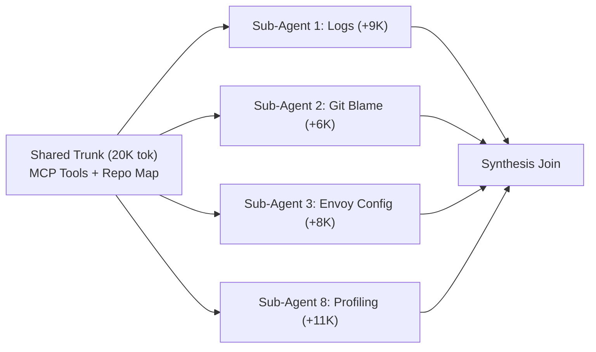
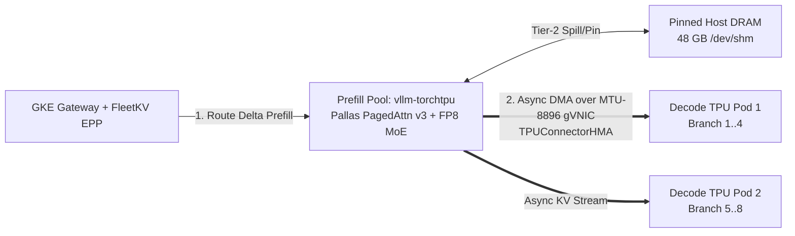

# Defeating the Prefix-Cache Penalty
### KV-Aware Routing & Disaggregated Serving for Agent Fleets on GKE

<div class="pt-6 text-lg opacity-90">
  <strong>Rabimba Karanjai</strong> · KubeCon 2026
</div>

<div class="pt-4 text-sm opacity-90">
  Gateway API Inference Extension · <span class="font-mono px-1.5 py-0.5 rounded bg-black/35">llm-d</span> · <span class="font-mono px-1.5 py-0.5 rounded bg-black/35">vllm-torchtpu</span> · GKE Cloud TPU
</div>

<!--
[00:00 - 00:35]
Kubernetes taught us a golden rule: treat pods as cattle, keep HTTP stateless, and let round-robin spread the load. Apply that rule to a fleet of autonomous AI agents today, and you will burn 80% of your accelerator budget recomputing tensors you calculated three seconds ago. Worse—as we'll see live in a few minutes—turning on naive prefix-sticky routing actually makes tail latency WORSE during parallel agent bursts. Here is how we solve both using Gateway API Inference Extension and disaggregated TorchTPU serving on GKE.
-->

---

# Chatbots Are Lines. Agent Fleets Are Trees.

<div class="grid grid-cols-2 gap-4 pt-1 text-xs">
<div>

### Chatbot Workload (2024)
- Single linear user session
- Human typing pace (15–30s think time)
- Small system prompt (~1K tokens)
- Predictable HBM footprint

</div>

<div>

### SWE / SRE Agent Fleet (2026)
- **20K Shared Trunk:** Repo AST + 120 MCP schemas + incident context
- **Fork-Storm (`t = 0ms`):** Orchestrator spawns **8 parallel sub-agents** simultaneously
- **Tool Bursts:** Sub-agents ingest 10K `kubectl logs` / `git diff` dumps
- **Join Turn:** Orchestrator synthesizes branches

</div>

</div>



<!--
[00:35 - 01:45]
Why do agent fleets break inference clusters? Because chatbots are lines, while agent fleets are trees. When an SRE or coding orchestrator wakes up on an alert, it builds a 20,000-token shared trunk—tool schemas, repository topology, alert state—and at millisecond zero, it forks 8 parallel sub-agents to inspect logs, traces, and diffs simultaneously. Over an episode, 88% of tokens across that tree are shared prefix blocks.
-->

---

# Failure Mode 1: Stateless K8s & The Scatter Penalty

Standard `kind: Service` scatters forked sub-agents randomly across $N$ replicas:

- **1/N Cache Collapse:** Pod A, Pod B, Pod C, and Pod D *all* recompute the identical 20K parent trunk on their Matrix Multiply Units (MXUs).
- **HBM Duplication:** Identical 20K FP8 KV blocks occupy $N \times$ High-Bandwidth Memory across the cluster.
- **Prefill-Decode Interference:** When Sub-Agent 3 dumps 10K log lines into an aggregated pod, compute-bound prefill stalls memory-bound decode for every co-located agent (P99 ITL spikes past 115 ms).

```text
 Orchestrator Fork (8x 20K Trunk) ──► K8s ClusterIP Service (Round-Robin)
    ├──► Pod 0: Recomputes 20K Trunk (Cache Miss) + Stalls Active Decodes
    ├──► Pod 1: Recomputes 20K Trunk (Cache Miss) + Stalls Active Decodes
    └──► Pod 2: Recomputes 20K Trunk (Cache Miss) + Stalls Active Decodes
```

<!--
[01:45 - 02:50]
Behind a standard Kubernetes Service, round-robin scatters those 8 forked children across every pod. Every pod misses on the trunk, recomputes 20,000 tokens of quadratic attention, wastes HBM storing duplicate copies, and—because prefill and decode share the same chip—any sub-agent dumping a 10K log trace stalls token generation for everyone else on that node.
-->

---

# Failure Mode 2 (Plot Twist): The Prefix-Herd Trap

What happens when you enable **Naive Longest-Prefix Affinity Routing**?

<div class="grid grid-cols-2 gap-6 pt-2">
<div>

1. **100% Match = Single-Pod Stampede**
   All 8 forked sub-agents share the *exact* 20K parent block hashes on **Pod 0**. Naive KV routing sends **all 8 concurrent branches to Pod 0**.
2. **Queue Explosion**
   Pod 0's prefill queue saturates while Pods 1..3 sit idle—spiking **P95 TTFT higher than Round-Robin**.
3. **Self-Inflicted HBM Thrash**
   As the 8 diverging branches append 8K–11K tool outputs on Pod 0, they overflow HBM and **LRU-evict their own 20K parent trunk** before the Join turn!

</div>
<div>

```text
 8 Forked Sub-Agents (Same 20K Hash)
          │
   [Naive KV Router: "100% Hit on Pod 0!"]
          │
          ▼
   ┌─────────────────────────────┐
   │ POD 0: MELTDOWN             │
   │ Queue: 8x Concurrent Bursts │
   │ HBM: 99.8% -> EVICTS TRUNK! │
   └─────────────────────────────┘
   ┌──────────┐  ┌──────────┐
   │ POD 1: 0%│  │ POD 2: 0%│ (Idle!)
   └──────────┘  └──────────┘
```

</div>
</div>

<!--
[02:50 - 04:30]
So we just turn on prefix-cache sticky routing, right? Here is the trap nobody warns you about. At fork time, all 8 sub-agents share the exact same 20,000-token parent hash on Pod 0. A naive KV-aware router sees a 100% cache match on Pod 0 and pile-drives all 8 sub-agents onto that single pod while the rest of your cluster sits idle! Worse: as those 8 branches grow in parallel, their diverging KV blocks overflow Pod 0's HBM and evict the shared parent trunk right before the synthesis step.
-->

---

# Why Routing & Disaggregation Are Inseparable

To defeat *both* Scatter and Herd penalties on agent trees, control plane and data plane must cooperate:

| Problem Layer | Naive Aggregated Cluster | **FleetKV + TorchTPU Disaggregated Stack** |
| :--- | :--- | :--- |
| **Shared 20K Trunk** | Recomputed $N$ times *or* herds onto 1 pod | **Computed ONCE** on Prefill TPU; pinned in Tier-2 Host DRAM |
| **8x Branch Fan-Out** | Queues serially or evicts HBM | **Admit-if-Fits** spreads branches across Decode TPUs |
| **10K Tool-Log Burst** | Stalls active decode ITL | Isolated on Prefill MXUs; Decode ITL stays flat |
| **KV State Mobility** | Trapped inside single pod HBM | Async **TPU Sync (`TPUConnectorHMA`)** streams over gVNIC |

<!--
[04:30 - 05:45]
This is why both halves of our architecture are mandatory. KV-aware routing without disaggregation traps your prefix on one pod and creates hot-spots. Disaggregation without KV-aware fit-routing recomputes prefixes unnecessarily. Put them together: Prefill computes the trunk once, pins it in host DRAM, computes tiny branch deltas, and streams KV state across multiple Decode pods that actually have HBM headroom.
-->

---

# Control Plane: Fit-Aware Tree Routing on GAIE

Built natively on **Gateway API Inference Extension (`v1`)** + Envoy `ext_proc` + ZeroMQ KV Events:

```go
// FleetKV Composite Admission & Scoring inside GAIE ext_proc
func ScoreEndpoint(pod *PodState, req *AgentBranchReq) float64 {
    // 1. Hard HBM Fit Gate: reject pod if branch horizon risks evicting hot trunk blocks
    if pod.FreeHBMBlocks < req.EstimatedDeltaBlocks + SafetyReserveBlocks {
        return RejectOverflowSpillToPeer
    }
    // 2. Balance exact ZMQ-tracked block residency against live prefill queue wait
    marginalSavedMs := float64(pod.ExactMatchedBlocks(req.BlockHashes)) * BlockPrefillCostMs
    queuePenaltyMs  := float64(pod.InFlightPrefillTokens) / PodThroughputTokPerMs
    return marginalSavedMs - queuePenaltyMs
}
```

- **Zero Guessing:** `vllm-torchtpu` streams `BlockStored` / `BlockRemoved` over ZMQ (`tcp://*:5557`) to keep an exact cluster-wide radix tree of 256-token blocks.
- **Fit-Gated Fan-Out:** Prevents HBM self-eviction by gating admission on free KV block horizon and coordinating P/D handoff headers.

<!--
[05:45 - 07:15]
Here is the core scoring logic inside our Gateway API Inference Extension Endpoint Picker. Every vllm-torchtpu prefill pod emits real-time ZeroMQ BlockStored and BlockRemoved events as 256-token blocks enter or leave memory. When Envoy calls our ext_proc router, we enforce an HBM Fit Gate first—if admitting an 8th branch would evict warm trunk blocks, we refuse to herd onto that pod—and then score marginal saved prefill milliseconds minus live queue delay.
-->

---

# Data Plane: `vllm-torchtpu` + `TPU Sync` on GKE

100% upstream PyTorch models running natively on **GKE Trillium (`ct6e-standard-4t`) / Ironwood TPUs**:



- **Zero Model Rewrites:** `torch.compile(backend="tpu")` lowers PyTorch into Pallas Ragged Paged Attention & fused FP8 MoE kernels.
- **`TPUConnectorHMA` (`TPU Sync`):** Asynchronous device-to-device & host-DRAM KV transfer overlaps network DMA with active decode steps—cutting fan-out transfer overhead below 35 ms.

<!--
[07:15 - 08:30]
Underneath, our DisaggregatedSet runs vllm-torchtpu on GKE TPU v6e slices. PyTorch models compile directly to Pallas paged-attention and FP8 MoE kernels. Prefill pods attach a 48-gigabyte pinned host DRAM tier via TPUConnectorHMA so shared agent trunks never get evicted, and stream delta KV blocks asynchronously over MTU-8896 jumbo-frame gVNIC directly into whichever Decode TPU slice won the Fit-Aware route. Time to see all three modes fight live.
-->

---
layout: center
class: text-center
---

# Live 3-Stage Traffic Flip on GKE
### 8x Parallel Sub-Agent Fork-Storms · `Qwen3-30B-A3B-FP8` · Equal 8-Chip TPU Budget

<div class="pt-6 text-left inline-block">

1. **`weight: 100` → Standard K8s `Service` (Round-Robin)** — *Watch Scatter Misses*
2. **`weight: 100` → Naive KV-Sticky `InferencePool`** — *Watch Prefix-Herd Queue & Evictions*
3. **`weight: 100` → `FleetKV` Fit-Aware + `vllm-torchtpu` Disagg** — *Watch TTFT & ITL Collapse*

</div>

<!--
[08:30 - 11:45]
[SWITCH TO TMUX TERMINAL]
1. Point out Stage 1 (Baseline Round-Robin already running): ~19% hit rate, 2.7s P50 TTFT, 118ms P99 ITL.
2. Run `./demo_ctl.sh stage2-naive-kv`: Show hit rate briefly spike to 78%, then P95 TTFT explodes past 3.3s as 8x forks herd onto one pod and HBM evictions drag hit rate back to ~51%!
3. Run `./demo_ctl.sh stage3-fleetkv-disagg`: Watch EPP logs spread decode branches while reusing prefill trunk. Hit rate locks >91%, P50 TTFT drops to ~315ms, P95 TTFT drops to ~480ms, P99 ITL flattens at ~27ms!
-->

---

# Equal-Hardware Benchmark Scorecard
Same **8 TPU v6e Chips** (`2x ct6e-standard-4t`) · **64 Active Agent Branches** (8 Orchestrators × 8-Way Fork)

| Metric | 1. K8s Round-Robin | 2. Naive KV-Sticky | **3. FleetKV + TorchTPU P/D** |
| :--- | :---: | :---: | :---: |
| **Effective Prefix Hit Rate** | 19.4 % | 52.8 % *(thrashing)* | **91.6 %** |
| **Median TTFT (P50)** | 2,710 ms | 1,180 ms | **315 ms (-88%)** |
| **Fork-Burst Tail TTFT (P95)** | 3,420 ms | 3,890 ms *(herd stall!)* | **485 ms (-86%)** |
| **Decode Jitter (P99 ITL)** | 116 ms | 98 ms | **27 ms (-77%)** |
| **Cluster Output Goodput** | 1.0x | 1.35x | **2.55x** |

<!--
[11:45 - 12:30]
Here is the exact scorecard on identical 8-chip TPU v6e hardware. Notice row three: Naive KV-Sticky actually made P95 tail TTFT WORSE than round-robin—3.89 seconds—because of fork-storm herding. Combining Fit-Aware KV routing with TorchTPU disaggregation cuts median TTFT by 88%, eliminates the fork-herd spike, flattens P99 decode latency to 27 milliseconds, and delivers 2.55x cluster goodput.
-->

---

# Three Production Scars (Save Your Weekend)

<div class="grid grid-cols-3 gap-4 pt-4 text-sm">
<div class="p-4 border rounded">

### 1. Pin `PYTHONHASHSEED=0`
Python salts process hashes by default. Without `PYTHONHASHSEED="0"` on **every** vLLM pod and router, identical 256-token blocks hash differently and P2P KV hits silently drop to `0%`.

</div>
<div class="p-4 border rounded">

### 2. TPU `--block-size 256`
GPU recipes default to `64`. On TPU v6e, block size `64` overflows Scalar Memory (SMEM) in Pallas paged attention. Set `--block-size 256` in vLLM **and** `blockSizeTokens: 256` in EPP.

</div>
<div class="p-4 border rounded">

### 3. ZMQ Role Filter + MTU 8896
Filter EPP ZMQ discovery to `llm-d.ai/role=prefill` so routers don't dial decode pods, and set GKE gVNIC VPC **`mtu: 8896`** so `TPU Sync` avoids packet fragmentation.

</div>
</div>

<!--
[12:30 - 13:30]
Three quick scars before you deploy this in production. One: pin PYTHONHASHSEED=0 everywhere or block hashes won't match across processes. Two: use 256-token blocks on TPU v6e so Pallas kernels don't overflow Scalar Memory, and match 256 in your router config. Three: filter ZMQ subscriptions strictly to prefill pods and turn on 8896 jumbo frames on your GKE VPC.
-->

---

# Stop Routing Agent Trees Like Stateless REST

<div class="grid grid-cols-2 gap-6 pt-4">
<div>

### Key Takeaways
- **Agents fork in bursts:** Naive sticky routing trades cache misses for hot-pod stampedes and HBM self-eviction.
- **Route on Fit + Marginal KV Delta:** Gate admission on HBM block headroom via GAIE `ext_proc` + ZeroMQ KV events.
- **Disaggregate on TorchTPU:** Compute trunks once on Prefill, pin in Host DRAM, fan out deltas via `TPU Sync`.

</div>
<div class="text-center p-4 border rounded">

### Apache-2.0 Open Source Repo
**`github.com/rkaranjai/kubecon26-fleetkv-gke`**

Includes:
- Go GAIE `ext_proc` `FleetKV` Router + ZMQ Indexer
- GKE TPU v6e Terraform + `DisaggregatedSet` YAML
- Local Docker Twin (rehearse on laptop!) + TUI

</div>
</div>

<!--
[13:30 - 14:00]
Agent fleets aren't stateless microservices, and they aren't linear chatbots. Everything you saw—the Go Envoy ext_proc Fit-Aware router, the GKE TorchTPU DisaggregatedSet manifests, a local Docker twin so you can test the 3-way flip on your laptop today, and the Slidev deck—is open source at this repo. Thank you, and I have a minute for a sharp question!
-->
