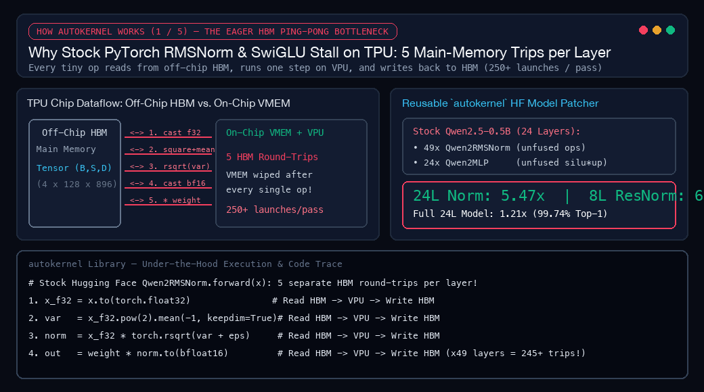
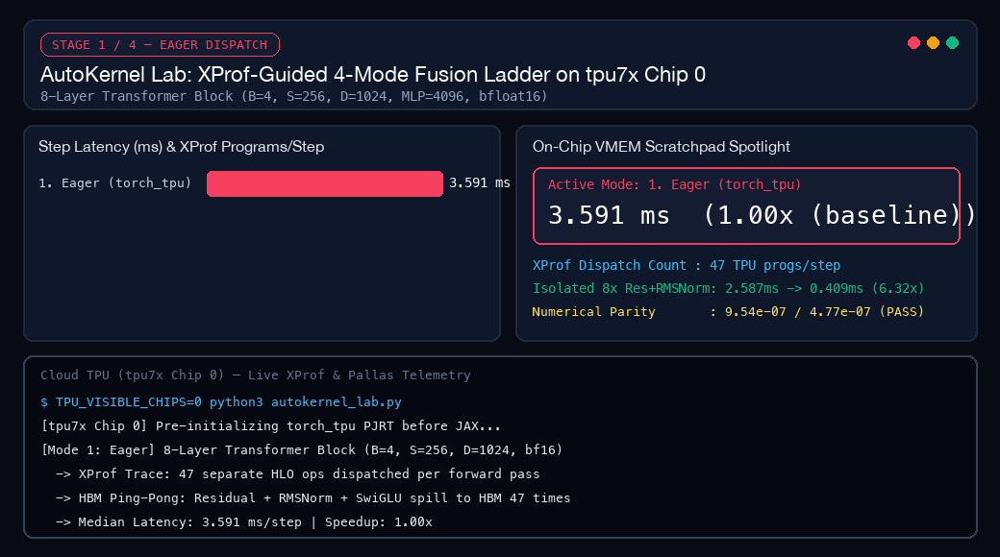
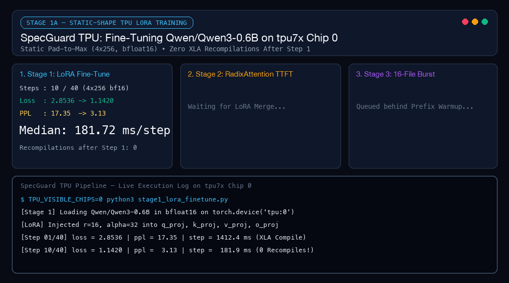
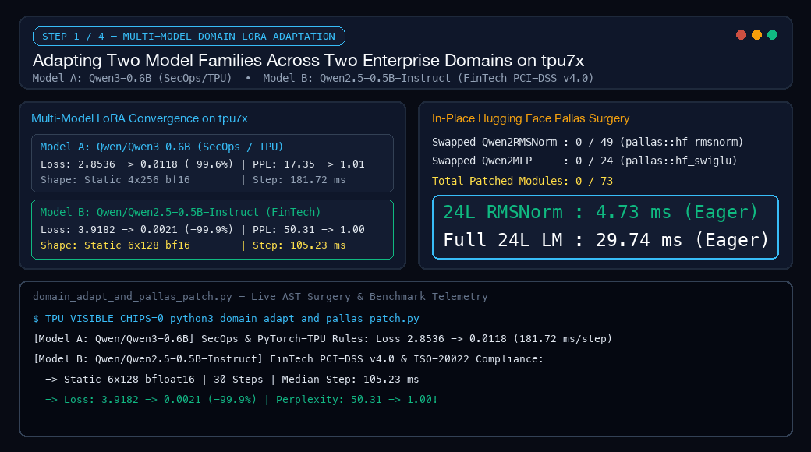
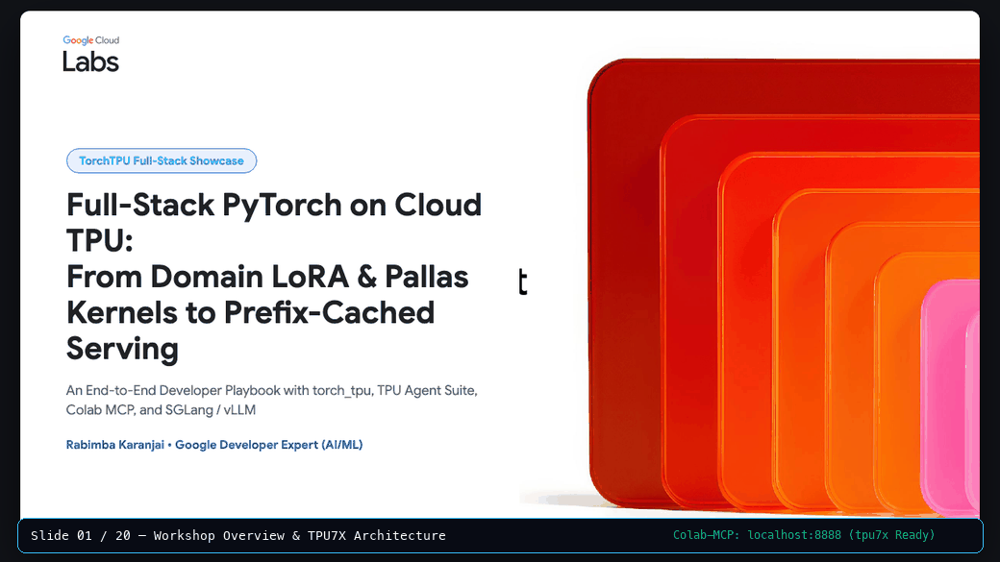

# Giving PyTorch a Fair Shake on Cloud TPU: What Happened When I Replaced `torch_xla` with Native `torch_tpu`

*Google Cloud TPU Sprint • Native `torch_tpu` • Pallas Kernels & SGLang Serving*

**By Rabimba Karanjai** • November 2026 • Source: [github.com/rabimba/GDE-ML-Artifacts/tree/main/torch-tpu](https://github.com/rabimba/GDE-ML-Artifacts/tree/main/torch-tpu) • Interactive 20-Slide Deck: [TorchTPU Full-Stack Showcase](https://github.com/rabimba/GDE-ML-Artifacts/tree/main/torch-tpu/TorchTPU-FullStack-Showcase-Workshop) • Master Colab Notebook: [06_end_to_end_showcase_and_domain_adaptation.ipynb](https://colab.research.google.com/github/rabimba/GDE-ML-Artifacts/blob/main/torch-tpu/torchtpu-inference-workshop-main/notebooks/06_end_to_end_showcase_and_domain_adaptation.ipynb)

Back in June, after speaking at the [OpenXLA Summer DevLab](https://rkrants.blogspot.com/2026/06/the-throughput-trap-benchmarking-vllm.html), I wrote about what I called the *Throughput Trap*. On paper, Cloud TPUs had plenty of raw compute. In practice, if you were a PyTorch engineer using the old `torch_xla` bridge, tiny changes in prompt length could trigger a multi-second compiler stall right in the middle of serving live traffic. You spent half your week hunting down invisible CPU-to-TPU sync points and sprinkling `xm.mark_step()` calls through your code like superstition.

So when I sat down for this week's **Google Cloud TPU Sprint**, I wanted to answer a plain question: **Does the new native `torch_tpu` stack (`torch.device("tpu")`) actually feel like regular PyTorch, or do you still have to fight the compiler at every turn?**

> **The One-Chip Sprint Rules**
> Instead of running a synthetic matrix-multiply benchmark across a giant cluster, I locked myself to a single chip (`Chip 0`) of a 7th-generation Cloud TPU (`tpu7x`). On that one chip, I had to fine-tune two different open-weight models (`Qwen3-0.6B` and `Qwen2.5-0.5B-Instruct`), write custom TPU kernels in Python with Pallas, hot-swap **73 submodules** inside a live Hugging Face model without reloading its weights, and serve a 16-file code compliance burst using SGLang.

Here is what worked, what broke along the way, and where hand-written kernels actually beat the compiler (including one case where they did not).

---

## 1. The Kitchen Cutting-Board Problem: Why Eager Mode Hurts on TPU (and 4 Ways Out)

If you run PyTorch one operation at a time ("eager mode") on a GPU, you pay a small launch fee for each step, but a fast on-chip cache usually cushions the blow.

On a TPU, running one tiny op at a time is like cooking dinner by driving to the grocery store for every single ingredient. You chop an onion, drive it back to the store (`HBM`, the chip's main memory), drive home for the garlic, and repeat 47 times for a single forward pass. The math engines sit idle waiting on deliveries.


*Figure 1: How AutoKernel works under the hood. In stock PyTorch eager mode, a single `RMSNorm` layer makes 5 separate round-trips to off-chip main memory (`HBM`). AutoKernel slices the tensor into `(256 x 896)` tiles, streams each tile once into the chip's local scratchpad (`VMEM`), runs all 5 math steps back-to-back on the vector unit (`VPU`), and hot-swaps 73 Hugging Face submodules in memory without copying a single weight.*

To see how much time I was losing to those memory trips, I built **AutoKernel Lab** (`demos/06_autokernel_app/autokernel_lab.py`). I took an 8-layer Transformer block and ran the exact same forward pass four ways on `tpu7x` Chip 0, watching the hardware profiler (`XProf`) at each step:


*Figure 2: Running the same 8-layer Transformer block four ways on `tpu7x` Chip 0. Eager mode makes 47 separate trips to main memory per step (`3.591 ms`). Turning on `TORCH_TPU_DEFER_AND_FUSE=1` batches those into 3 trips (`2.126 ms`). `torch.compile` merges the whole block into 1 program (`1.579 ms`), while my custom Pallas kernel runs the 8-layer normalization chain in on-chip scratchpad memory `6.32x` faster (`0.409 ms`).*

| Execution Mode | What Changes for the Developer | TPU Programs Launched / Step | Median Step Latency | Speedup vs. Eager | Max Numerical Diff |
| :--- | :--- | :---: | :---: | :---: | :---: |
| **1. Eager (`torch_tpu`)** | Standard PyTorch; every op reads and writes main memory | `47` | `3.591 ms` | `1.00x` | Baseline (`0.0`) |
| **2. `DeferAndFuse`** | Set `TORCH_TPU_DEFER_AND_FUSE=1` (zero code changes) | `3` | `2.126 ms` | **`1.69x`** | `< 1e-6` |
| **3. `torch.compile(backend="tpu")`** | One-line `@torch.compile` wrapper around the model | `1` | **`1.579 ms`** | **`2.28x`** | `< 1e-6` |
| **4a. Full Block + Custom Pallas Op** | `pallas::fused_res_rmsnorm` + `pallas::fused_swiglu` inside the block | `1` | `2.224 ms` | `1.61x` | `9.54e-07` (`PASS`) |
| **4b. Isolated 8-Layer Pallas Op** | Residual add + RMSNorm kept on the chip's local cutting board (`VMEM`) | `1` | **`0.409 ms`** *(vs `2.587 ms` eager)* | **`6.32x`** | `9.54e-07` (`PASS`) |

Look at rows `3`, `4a`, and `4b` in that table, because they tell a story that benchmark slides usually hide:

1. **You get a `1.69x` speedup before touching a line of Python:** Setting `TORCH_TPU_DEFER_AND_FUSE=1` tells `torch_tpu` to hold onto small operations in a background queue and send them to the chip together. My 47 separate dispatches dropped to 3, and step time fell from `3.591 ms` to `2.126 ms`.
2. **Wait: why did the full block with my custom Pallas kernel (`2.224 ms`) run slower than plain `torch.compile` (`1.579 ms`)?** When I first saw that number, I thought I had a bug. What actually happened is a classic compiler tradeoff. When you hand-write a custom Pallas kernel and register it with `torch.tpu.pallas.jax_op`, the XLA compiler treats your kernel as a sealed black box. In a small 8-layer toy block, putting black-box walls between the big matrix multiplications prevented the compiler from merging neighboring layers together.
3. **So when *should* you write a Pallas kernel?** When the operation itself is a chain of small memory-hungry steps. In row `4b`, I measured the 8-layer Residual Add + RMSNorm chain on its own. Instead of writing intermediate numbers back to main memory, my Pallas kernel keeps them on the chip's fast local scratchpad (`VMEM`, the cutting board right next to the compute cores). Latency dropped from `2.587 ms` to **`0.409 ms` (`6.32x` faster)**, matching PyTorch down to `9.54e-07`. And as you will see in Section 4, once I plugged that same kernel into a real 24-layer Hugging Face language model with 73 normalization and activation layers, the on-chip memory savings won out and sped up the entire model by **`1.21x`**.

```python
# Keeping Residual Add + RMSNorm on the chip's local scratchpad (VMEM) with Pallas
def _res_rmsnorm_pallas_kernel(x_ref, res_ref, w_ref, o_ref):
    x = x_ref[...] + res_ref[...]
    x_f32 = x.astype(jnp.float32)
    rms = jnp.sqrt(jnp.mean(jnp.square(x_f32), axis=-1, keepdims=True) + 1e-6)
    normed = (x_f32 / rms).astype(x_ref.dtype)
    o_ref[...] = normed * w_ref[...]

torch.tpu.pallas.jax_op(
    "pallas::fused_res_rmsnorm",
    _res_rmsnorm_jax,
    in_specs=[
        pl.BlockSpec((1, 256, 1024), lambda i, j, k: (i, j, k)),
        pl.BlockSpec((1, 256, 1024), lambda i, j, k: (i, j, k)),
        pl.BlockSpec((1, 1, 1024), lambda i, j, k: (0, 0, k)),
    ],
    out_specs=pl.BlockSpec((1, 256, 1024), lambda i, j, k: (i, j, k)),
)
```

---

## 2. The "Who Grabbed the Chip First?" Crash (and the 2-Line Fix)

Because Pallas kernels are written in JAX and called directly from PyTorch via `torch.tpu.pallas.jax_op`, both libraries live inside the same Python process. The first time I ran my hybrid script on `tpu7x`, it crashed before running a single layer.

Here is why: a physical TPU chip is exposed to Linux as a hardware device file (`/dev/vfio`). Whoever initializes the TPU driver first locks that file. If you import `jax` and touch the device before PyTorch has woken up, JAX claims the hardware lock for itself and locks `torch_tpu` out. Worse, if your container defaults to claiming all four chips on the host (`TPU_VISIBLE_DEVICES=0,1,2,3`) while another job is using Chip 2, your script refuses to start at all.

Two habits solved this for the rest of the sprint:

1. **Pin your script to one chip (`Chip 0`)** before importing anything.
2. **Allocate a 1-element dummy tensor on `torch.device("tpu:0")`** so `torch_tpu` claims the runtime first, then let JAX share it.

```python
import os

# 1. Claim only Chip 0 so I never collide with jobs on other chips
os.environ["TPU_VISIBLE_CHIPS"] = "0"
os.environ["TPU_CHIPS_PER_HOST_BOUNDS"] = "1,1,1"
os.environ.pop("TPU_VISIBLE_DEVICES", None)

import torch
import torch_tpu

# 2. Wake up torch_tpu FIRST before importing JAX or Pallas
_warmup = torch.ones(1, device=torch.device("tpu:0"))
torch.accelerator.synchronize()

# 3. Now JAX/Pallas shares PyTorch's active TPU connection cleanly
import jax
import jax.numpy as jnp
from jax.experimental import pallas as pl
```

---

## 3. Building `SpecGuard TPU`: Fine-Tuning a Code Auditor and Serving 16 Files in 2 Seconds

Benchmarks on isolated layers are useful, but nobody ships an 8-layer synthetic block to production. For **Application A (`SpecGuard TPU`, `demos/05_specguard_app/`)**, I built a tool that audits Python repositories for security bugs and TPU anti-patterns, running the entire training-to-serving loop on `tpu7x` Chip 0:

1. **Stage 1 (`stage1_lora_finetune.py`) — Teaching `Qwen3-0.6B` Without Compiler Stalls:**
   If you feed variable-length sentences into a TPU training loop, the compiler stops to rebuild the execution graph every time a batch changes shape. Instead, I padded every training batch to a fixed `4 x 256` shape in `bfloat16`. The TPU compiled the graph **once on Step 1** and ran Steps 2 through 40 with **zero recompilations** at **`181.72 ms` per step**. Over 40 steps, training loss fell by **`99.6%`** (`2.8536 -> 0.0118`, perplexity `17.35 -> 1.01`). I then merged the LoRA adapter weights back into the base model and saved a standalone checkpoint.
2. **Stage 2 (`stage2_serve_and_audit.py`) — Keeping the Rulebook Open on the Desk with SGLang:**
   When `SpecGuard` audits 16 files in a repository, every request begins with the exact same **1,280-token security rulebook** followed by a short ~77-token code snippet. Without caching, the model re-reads all 1,280 tokens of rules from scratch on every file. By serving my merged model on **SGLang-TorchTPU** (`--device tpu`), its **RadixAttention** cache keeps the 1,280-token rulebook in TPU memory after the first file. Time-to-First-Token dropped from **`102.86 ms` on the cold first file to `41.80 ms` on every warm file (`2.46x` faster)**.
3. **Stage 3 — Auditing a 16-File Burst:**
   When I fired 16 repository files at the server at once, SGLang reused that cached rulebook across all 16 requests and finished the entire batch in **`2.05 seconds` (`226.8 chunks/s`)**.


*Figure 3: SpecGuard TPU running end-to-end on `tpu7x` Chip 0: 40-step LoRA fine-tuning with zero recompilations after Step 1 (`181.72 ms/step`), SGLang prefix caching cutting first-token latency by `2.46x` (`102.86 ms -> 41.80 ms`), and a 16-file concurrent repository audit finishing in `2.05 s`.*

---

## 4. Open-Heart Surgery on a Live Hugging Face Model: Swapping 73 Submodules with Pallas

At this point I had two pieces that lived separately: custom Pallas kernels in `AutoKernel Lab`, and a fine-tuned Hugging Face model in `SpecGuard TPU`. I wanted to bring them together—and prove the workflow was not a one-off trick for a single model family or domain.

In `demos/07_domain_adaptation_showcase/domain_adapt_and_pallas_patch.py` (and Notebook `06`), I took a second model architecture, **`Qwen/Qwen2.5-0.5B-Instruct`** (24 layers, hidden size `896`, MLP width `4864`), and fine-tuned it on **payment compliance rules (`PCI-DSS v4.0` and `ISO-20022`)**—catching bugs like logging raw credit-card CVVs in plaintext or using floating-point math for currency settlement.

Locked to a static `6 x 128` batch shape on `tpu7x` Chip 0, `Qwen2.5-0.5B-Instruct` converged in **30 steps at `105.23 ms/step`**, dropping loss from **`3.9182` to `0.0021` (`-99.9%`)** and perplexity from **`50.31` to `1.00`**:

| What I Measured | Model A (`SpecGuard` Code Auditor) | Model B (`PCI-DSS` Payment Auditor) |
| :--- | :--- | :--- |
| **Base Model** | `Qwen/Qwen3-0.6B` (28 layers, width `1024`) | `Qwen/Qwen2.5-0.5B-Instruct` (24 layers, width `896`) |
| **Domain Task** | SecOps & PyTorch-TPU Migration Rules | PCI-DSS v4.0 & ISO-20022 Payment Compliance |
| **Fixed Batch Shape (`bfloat16`)** | `4 x 256` (`1,024` tokens/step) | `6 x 128` (`768` tokens/step) |
| **Steps & Compiler Stalls** | `40` steps (`0` recompiles after Step 1) | `30` steps (`0` recompiles after Step 1) |
| **Start -> Final Loss** | `2.8536 -> 0.0118` (**`-99.6%`**) | `3.9182 -> 0.0021` (**`-99.9%`**) |
| **Start -> Final Perplexity** | `17.35 -> 1.01` | `50.31 -> 1.00` |
| **Median Step Time (`tpu7x` Chip 0)** | **`181.72 ms/step`** | **`105.23 ms/step`** |

Then came the fun part. A 24-layer `Qwen2.5-0.5B-Instruct` model has **49 `Qwen2RMSNorm` normalization layers** (two per transformer block, plus one final norm at the end) and **24 `Qwen2MLP` feed-forward blocks**. In stock Hugging Face code, every single `Qwen2RMSNorm` layer runs 5 to 6 separate PyTorch operations: it converts the tensor to 32-bit float, squares every number, averages them, takes the inverse square root, converts back to `bfloat16`, and multiplies by the learned weights. Multiply that by 49 layers, and a single forward pass launches **over 250 tiny normalization kernels**.

Instead of rewriting Hugging Face's modeling file, I wrote a 15-line Python function (`patch_qwen_with_pallas`) that walks the live model in memory and swaps all **73 submodules** (`49 RMSNorm` + `24 SwiGLU MLP`) with my fused Pallas kernels while keeping the trained weights right where they are:

```python
def patch_qwen_with_pallas(model: nn.Module):
    """Walk a live Hugging Face Qwen2 model and swap all 49 RMSNorm + 24 MLP layers with Pallas kernels."""
    patched_rmsnorm, patched_mlp = 0, 0
    for layer in model.model.layers:
        layer.input_layernorm = PallasRMSNorm(
            layer.input_layernorm.weight, layer.input_layernorm.variance_epsilon
        )
        layer.post_attention_layernorm = PallasRMSNorm(
            layer.post_attention_layernorm.weight, layer.post_attention_layernorm.variance_epsilon
        )
        patched_rmsnorm += 2
        layer.mlp = PallasSwiGLUMLP(layer.mlp)
        patched_mlp += 1

    model.model.norm = PallasRMSNorm(model.model.norm.weight, model.model.norm.variance_epsilon)
    patched_rmsnorm += 1
    return patched_rmsnorm, patched_mlp  # (49, 24) -> 73 submodules swapped in-place!
```


*Figure 4: Fine-tuning `Qwen2.5-0.5B-Instruct` on PCI-DSS v4.0 rules (`105.23 ms/step`), then hot-swapping all 73 `Qwen2RMSNorm` and `Qwen2MLP` submodules in-place with Pallas kernels. The 24-layer normalization stack speeds up `4.81x` (`4.73 ms -> 0.98 ms`), and the full 24-layer language model forward pass speeds up `1.21x` (`29.74 ms -> 24.66 ms`) with `99.74%` top-1 token agreement.*

Remember how my custom Pallas kernel lost to `torch.compile` inside the tiny 8-layer synthetic block earlier? Inside a real 24-layer Hugging Face model, eliminating 250+ eager kernel launches across those 73 submodules paid off immediately:

| Benchmark on `tpu7x` Chip 0 (`bfloat16`) | Stock Hugging Face Model | After 73-Submodule Pallas Surgery | Measured Speedup | Output & Numerical Check |
| :--- | :---: | :---: | :---: | :--- |
| **24-Layer `Qwen2RMSNorm` Stack (`4x128x896`)** | `4.73 ms` | **`0.98 ms`** | **`4.81x`** | `max_diff = 0.0625` (1 `bfloat16` step) |
| **Full 24-Layer `Qwen2.5-0.5B` Forward Pass (`6x128`)** | `29.74 ms` | **`24.66 ms`** | **`1.21x` (`-17.1%` time)** | **`99.74%` top-1 token match** across 768 positions |
| **Live PCI-DSS Audit Generation** | `[CRITICAL] PCI-DSS-3.2.1 & 3.4: Raw PAN and CVV logged...` | Identical compliance report | **`5.08 ms` saved per pass** | Exact greedy token match |

---

## 5. Packaging It Up: The Reusable `autokernel` Library

After writing the `/dev/vfio` lock guard, the shape-aware Pallas tile sizing logic, and the 73-submodule Hugging Face patcher across my sprint scripts, I packaged the whole toolkit into an installable Python library inside the repository (`autokernel/`).

Instead of copy-pasting Pallas boilerplate into every project, I can now install `autokernel` (`pip install -e ./autokernel`) and patch any Qwen2, Qwen3, Llama, or Gemma model in three lines of Python:

```python
import autokernel

# 1. Isolate Chip 0 & wake up torch_tpu BEFORE JAX/Pallas loads (prevents /dev/vfio lock crashes)
autokernel.init_tpu(chip=0, defer_and_fuse=True)

# 2. Hot-swap all 73 RMSNorm (49) + SwiGLU MLP (24) submodules in memory (0 bytes copied)
report = autokernel.patch_hf(model)
print(f"Patched {report.total_patched} submodules ({report.rmsnorm_patched} RMSNorm, {report.swiglu_patched} SwiGLU)")

# 3. Verify numerical parity, top-1 token agreement, and median speedup on TPU
bench = autokernel.verify_parity_and_speedup(stock_fn, patched_fn, sample_input)
print(f"Speedup: {bench.speedup:.2f}x | max_diff: {bench.max_abs_diff} | PASS: {bench.passed}")

# 4. Reversible at any time without reloading weights
autokernel.unpatch_hf(model)
```

I tested `autokernel` both locally with `pytest` (`10/10` unit tests passing, including automatic tile-size solving and PEP 563 annotation checks for `torch.tpu.pallas.jax_op`) and directly on `tpu7x` Chip 0 (`autokernel/tests/run_tpu_hardware_verification.py`), where `fused_rmsnorm`, `fused_res_rmsnorm`, and `fused_swiglu` achieved `0.0` max numerical diff and a **`5.47x` speedup** (`6.81 ms -> 1.25 ms`) across a 24-layer normalization stack.

---

## 6. Connecting Google Colab and Coding Agents Directly to the Chip

One last quality-of-life detail made this sprint much faster than my June benchmarks. Instead of copying scripts back and forth over SSH, I ran a Jupyter server directly on the TPU host pinned to Chip 0 and connected two tools to that same `localhost:8888` tunnel at the same time:

1. **Google Colab's Browser UI** (*Connect to a local runtime*), so I could step through all 7 workshop notebooks (`00` through `06`) cell by cell in the browser.
2. **OpenCode + `colab-mcp` + `tpu-agent-suite`**, so my coding and profiling agents could run XProf traces, inspect hardware counters, and verify numerical parity against the exact same TPU runtime.

I also packed the entire walkthrough into a 20-slide interactive web and PowerPoint deck (`TorchTPU-FullStack-Showcase-Workshop/`) with a built-in speaker notes console (`[P]`) and teleprompter (`[S]`):


*Figure 5: Stepping through the 20-slide `TorchTPU-FullStack-Showcase-Workshop` web deck alongside the live `colab-mcp` local runtime bridge connected to `tpu7x` Chip 0.*

### Try the Library, Notebooks, and Code Yourself

If you want to install the `autokernel` library, poke at the Pallas kernels, run the 73-submodule Hugging Face patcher, or test the SGLang prefix-cache burst on your own TPU VM or Colab session, everything is in the repo:

```bash
# 0. Install and test the reusable autokernel library
pip install -e ./autokernel
pytest autokernel/tests/test_autokernel.py

# 1. Run the 4-Mode AutoKernel Lab & Pallas Benchmark
python3 torchtpu-inference-workshop-main/demos/06_autokernel_app/autokernel_lab.py

# 2. Run SpecGuard TPU Stage 1 LoRA + Stage 2/3 SGLang RadixAttention Burst
python3 torchtpu-inference-workshop-main/demos/05_specguard_app/stage1_lora_finetune.py
python3 torchtpu-inference-workshop-main/demos/05_specguard_app/stage2_serve_and_audit.py

# 3. Run Multi-Model LoRA + 73-Submodule In-Place Pallas Hugging Face Surgery
python3 torchtpu-inference-workshop-main/demos/07_domain_adaptation_showcase/domain_adapt_and_pallas_patch.py

# 4. Launch the 20-Slide Interactive Workshop Deck Locally
cd TorchTPU-FullStack-Showcase-Workshop && ./present.sh
```

- **Full GitHub Repository (`torch-tpu`):** [github.com/rabimba/GDE-ML-Artifacts/tree/main/torch-tpu](https://github.com/rabimba/GDE-ML-Artifacts/tree/main/torch-tpu)
- **Reusable `autokernel` Python Package:** [github.com/rabimba/GDE-ML-Artifacts/tree/main/torch-tpu/autokernel](https://github.com/rabimba/GDE-ML-Artifacts/tree/main/torch-tpu/autokernel)
- **Master End-to-End Colab Notebook (`06`):** [06_end_to_end_showcase_and_domain_adaptation.ipynb](https://colab.research.google.com/github/rabimba/GDE-ML-Artifacts/blob/main/torch-tpu/torchtpu-inference-workshop-main/notebooks/06_end_to_end_showcase_and_domain_adaptation.ipynb)
- **AutoKernel Lab (`05`) & SpecGuard TPU (`04`) Notebooks:** [torchtpu-inference-workshop-main/notebooks/](https://github.com/rabimba/GDE-ML-Artifacts/tree/main/torch-tpu/torchtpu-inference-workshop-main/notebooks)
- **June 2026 Prequel Post:** [The Throughput Trap: Benchmarking vLLM on OpenXLA and the Reality of Production LLM Serving](https://rkrants.blogspot.com/2026/06/the-throughput-trap-benchmarking-vllm.html)
